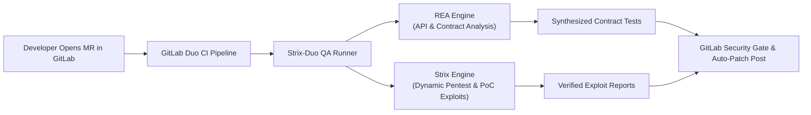

# Strix-Duo QA: Autonomous DevSecOps Lifecycle Verification Agent

> **Submission for GitLab "Life After Code" Transcend Hackathon (Devpost)**  
> *Category: DevSecOps Lifecycle Automation & Testing*  
> **Author:** Mejbaur Bahar (`fagun115946@gmail.com`)  
> **Built with:** [GitLab Duo](https://docs.gitlab.com/user/duo_agent_platform/), [Strix AI Pentester](https://github.com/usestrix/strix), [REA Agent](https://github.com/morluto/rea)

---

## 💡 The Problem: "Life After Code"

AI code generation is largely solved. Modern LLMs write code in seconds. But what happens after the code is generated?
1. **Broken APIs & Hidden Regressions:** Generated endpoints often drift from contracts or forget auth middleware.
2. **Critical Security Holes:** AI frequently produces code vulnerable to OWASP Top 10 vulnerabilities (IDOR, Broken Access Control, SQL Injection).
3. **Manual QA Bottlenecks:** Human QA teams cannot keep up with the velocity of AI-generated Merge Requests (MRs).

---

## 🚀 The Solution: Strix-Duo QA

**Strix-Duo QA** is an autonomous multi-agent testing engine designed specifically for the GitLab Duo Agent Platform and GitLab CI/CD pipelines.

Instead of passive linters or brittle static analysis, Strix-Duo orchestrates two specialized intelligence agents:
- **REA (Reverse Engineering Agent)**: Dynamically inspects API routes, binary dependencies, and runtime data contracts to catch schema drifts and missing authentication guards.
- **Strix (Autonomous AI Penetration Testing Agent)**: Launches real, dynamic exploits against the staging application, proving vulnerabilities with working Proof-of-Concept (PoC) scripts.

### What Strix-Duo Does on Every Merge Request:
1. **Intercepts Merge Requests in GitLab CI/CD.**
2. **Reverse engineers API surface and models runtime behavior.**
3. **Dynamically attacks the endpoints to uncover live exploits.**
4. **Synthesizes executable Proof-of-Concept (PoC) scripts.**
5. **Generates verified, copy-paste diff patches directly on the GitLab MR discussion thread.**

---

## 🛠️ Architecture



---

## ⚡ Quick Start

### Installation
```bash
git clone https://github.com/fagun18/strix-duo-qa.git
cd strix-duo-qa
pip install -e .
```

### Run Local DevSecOps Audit
```bash
strix-duo --target "http://localhost:8000" --mr-id "104" --output "gl-security-qa-report.md"
```

### Add to `.gitlab-ci.yml`
```yaml
strix_duo_qa:
  stage: test
  image: python:3.11-slim
  script:
    - pip install strix-duo-qa
    - strix-duo --target "$STAGING_URL" --mr-id "$CI_MERGE_REQUEST_IID"
```

---

## 🏆 Hackathon Value & Impact
- **Zero Hallucination Proof**: Generates actual runnable `curl` / python scripts demonstrating exact exploits.
- **Turnkey DevSecOps**: Seamlessly plugs into GitLab CI/CD without requiring external infrastructure.
- **Enterprise-Grade**: Adheres to OWASP Top 10 and ISTQB/IEEE 829 testing standards.
